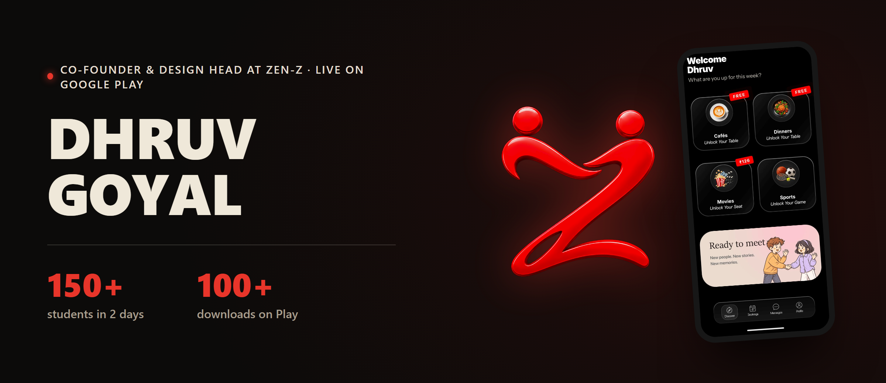
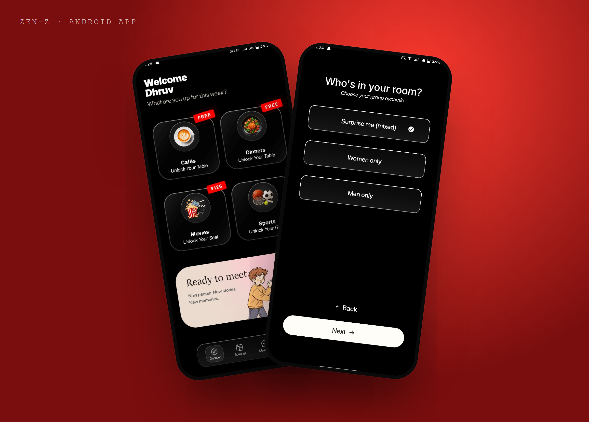
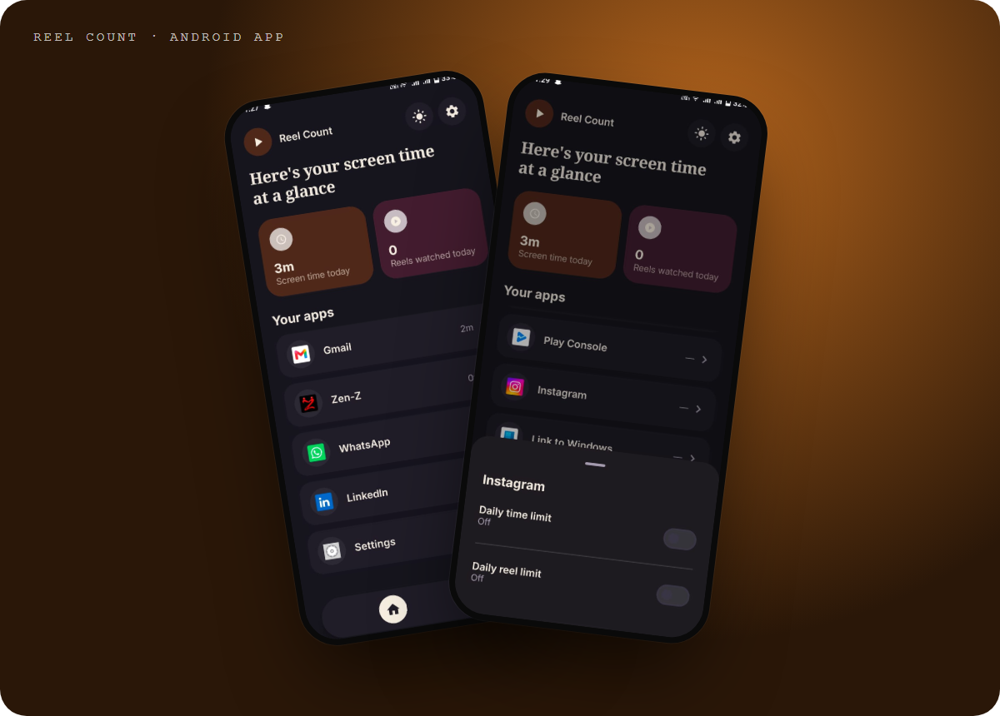
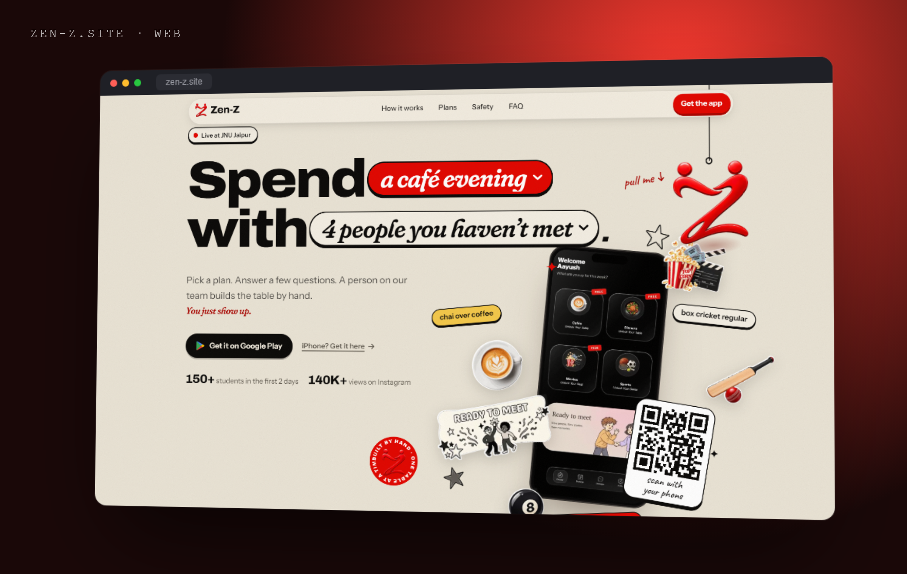
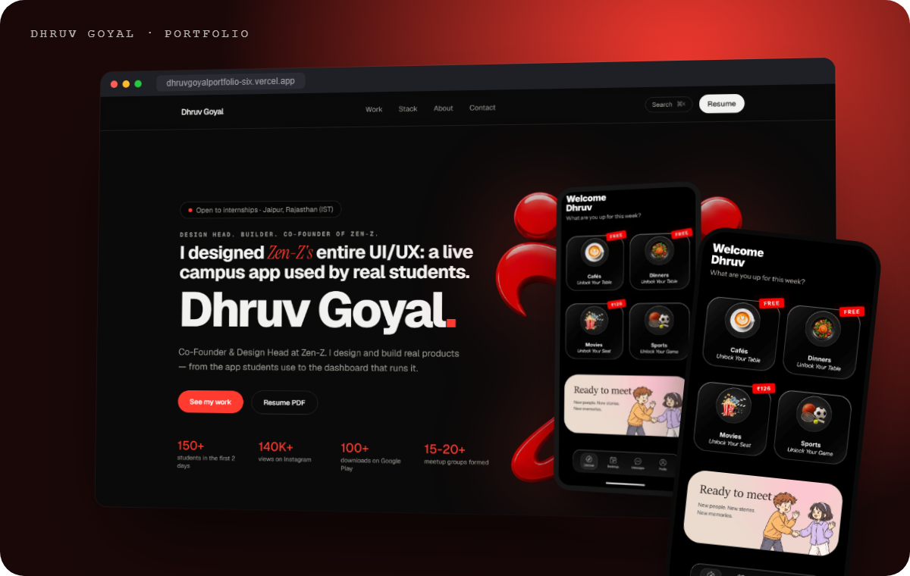
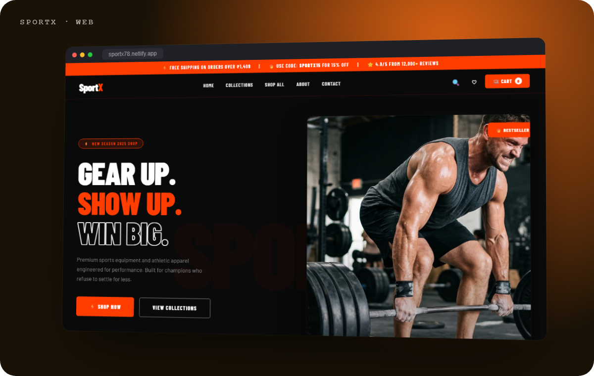

I'm the Co-Founder & Design Head at [Zen-Z](https://zen-z.site), where I design and build real products end to end — from the campus app students use every day to the admin dashboard that runs it. 
B.Tech CSE student at Jaipur National University, Jaipur (Class of 2028, CGPA 9.0), mostly self-taught. 
I build on my own outside Zen-Z too — Reel Count was designed and shipped solo in a week. 
Open to Frontend / Full-Stack / Mobile internships, based in Jaipur, Rajasthan.

### Featured work

<table>
<tr>
<td width="50%" valign="top">

 
<b>Zen-Z</b>: 150+ users in 2 days, 100+ downloads on Google Play. Campus meetup app — designed the complete booking UI/UX.
 
<a href="https://play.google.com/store/apps/details?id=com.campussocial.app">Play Store</a> &middot; <a href="https://zen-z.site">Site</a> &middot; <a href="https://dhruvgoyalportfolio-six.vercel.app/work/zen-z">Case study</a>
</td>
<td width="50%" valign="top">

 
<b>Reel Count</b>: built solo in 1 week. Offline Android digital-wellbeing app (Kotlin, Jetpack Compose).
 
<a href="https://github.com/dhruv-7808/reel-count">Code</a> &middot; <a href="https://dhruvgoyalportfolio-six.vercel.app/work/reel-count">Case study</a>
</td>
</tr>
<tr>
<td width="50%" valign="top">

 
<b>zen-z.site</b>: hand-built, sticker-collage marketing site for Zen-Z. Designed the visuals and brand world end to end.
 
<a href="https://zen-z.site">Live</a> &middot; <a href="https://dhruvgoyalportfolio-six.vercel.app/work/zen-z-site">Case study</a>
</td>
<td width="50%" valign="top">

 
<b>Portfolio</b>: Next.js, TypeScript, Tailwind CSS and Motion. A phone cycles through real Zen-Z screens in the hero.
 
<a href="https://dhruvgoyalportfolio-six.vercel.app">Live</a> &middot; <a href="https://github.com/dhruv-7808/portfolio">Code</a>
</td>
</tr>
<tr>
<td colspan="2" valign="top">

 
<b>SportX</b>: HTML, CSS, JavaScript. Sports e-commerce storefront built to practice frontend fundamentals.
 
<a href="https://sportx7.netlify.app">Live</a> &middot; <a href="https://github.com/dhruv-7808/SportX">Code</a>
</td>
</tr>
</table>

### Stack

          

### Contact

**[Portfolio](https://dhruvgoyalportfolio-six.vercel.app)** &middot; **[LinkedIn](https://linkedin.com/in/dhruv-goyal-494991313)** &middot; **[Email](mailto:dhruvgm78@gmail.com)** &middot; **[Resume](https://dhruvgoyalportfolio-six.vercel.app/resume/Dhruv_Goyal_Resume.pdf)**
